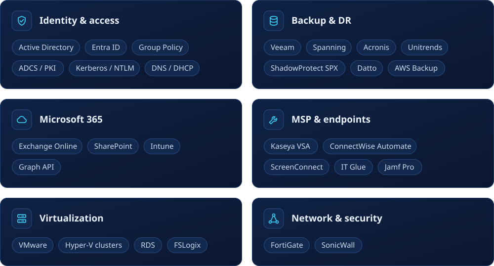

  <a href="mailto:rehank9540@gmail.com">rehank9540@gmail.com</a>

Plain-text version

### Rehan Khan
Advanced System Administrator at IT By Design · New Delhi, India

~6 years in MSP and enterprise IT. I own L2/L3 escalations for US-based clients across Windows Server, Active Directory, Entra ID, Microsoft 365, virtualization and backup/DR, and mentor the engineers coming up behind me. Before that: Microsoft Premier support for enterprise Directory Services (AD, Kerberos, NTLM, ADCS/PKI, Group Policy).

**Internal tooling**
- **FastPatch** — patch classification and remediation through Kaseya VSA; 600+ machines patched at 99% success, macOS support next
- **SpanningAuditor** — read-only Spanning backup coverage audit across 200+ Microsoft 365 tenants
- **EWSHardcore** — Exchange Online EWS audit and remediation across the tenant fleet
- **SBHIT** — SharePoint backup health investigation via the Graph delta API (3M+ items / 2.1 TB), DuckDB analysis
- **FSLogix toolkit** — read-only profile health checks and forensics for RDS session hosts
- **DeviceDiag** — endpoint audit for leftover MDM, Autopilot and RMM, hardware health and licensing

**Projects**
- [technical-analysis-agent](https://github.com/rehan-123/technical-analysis-agent) — technical-analysis specialist for a multi-agent investment platform; Python, FastAPI, Pydantic; 240 tests passing
- **ecom-autopilot** (private) — decision engine and operating layer for Indian marketplace selling; Python, FastAPI, React; 1,029 tests passing
- **meridian** (private, in development) — decision-first paper-trading terminal for Indian equities; FastAPI, React, TypeScript

**Certifications** — AZ-800, AZ-801, MD-102, VMCE, ConnectWise Automate Certified Professional, Jamf Certified Associate

