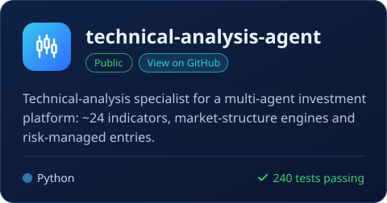
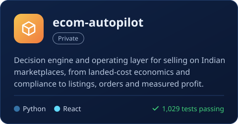
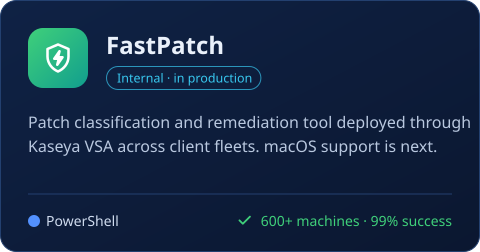
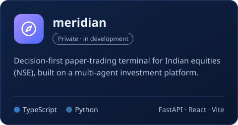
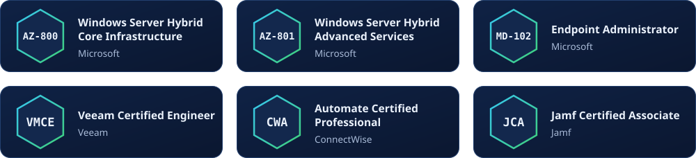

## 🧭 About me

- 🛡️ I own **L2/L3 escalations** for US-based clients at an MSP: Windows Server, Active Directory, Entra ID, Microsoft 365, virtualization and backup/DR
- 🧠 I came up through **Microsoft Premier support** for enterprise Directory Services: AD, Kerberos, NTLM, ADCS/PKI and Group Policy
- ⚡ I turn repetitive NOC work into tooling with **PowerShell, Microsoft Graph and Python**, and lately LLM-assisted agents
- 🤝 I mentor new system administrators and support technicians on my team

## 🧰 Tech stack

  

## 🚀 Projects

  
  
  
  

## ⚙️ Built for the NOC

Internal tools I've written for day-to-day operations. The code isn't public.

| | Tool | What it does |
|:-:|---|---|
| 🗄️ | **SpanningAuditor** | Read-only Spanning backup coverage audit across **200+ Microsoft 365 tenants** |
| 📬 | **EWSHardcore** | Exchange Online EWS audit and remediation across the tenant fleet |
| 📂 | **SBHIT** | SharePoint backup health investigation via the Graph delta API — **3M+ items / 2.1 TB** |
| 👤 | **FSLogix toolkit** | Read-only profile health checks and forensics for RDS session hosts |
| 💻 | **DeviceDiag** | Finds leftover MDM, Autopilot and RMM on endpoints, plus hardware and licensing state |

## 🏅 Certifications

## 📫 Get in touch

