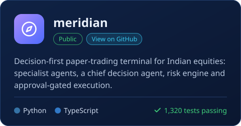
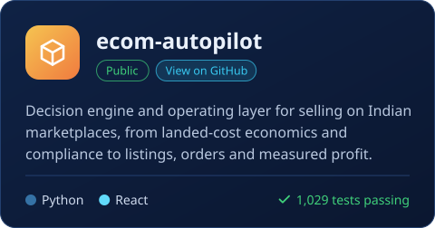
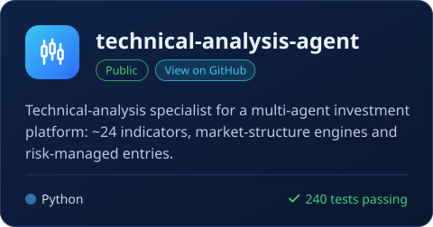
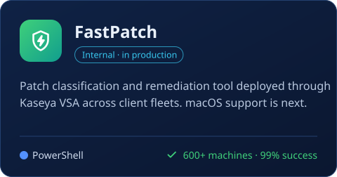

## 🧭 About me

- 🛡️ I own **L2/L3 escalations** for US-based clients at an MSP: Windows Server, Active Directory, Entra ID, Microsoft 365, virtualization and backup/DR
- 🧠 I came up through **Microsoft Premier support** for enterprise Directory Services: AD, Kerberos, NTLM, ADCS/PKI and Group Policy
- ⚡ I turn repetitive NOC work into tooling with **PowerShell, Microsoft Graph and Python**, and lately LLM-assisted agents
- 🤝 I mentor new system administrators and support technicians on my team

## 🧰 Tech stack

  

## 🚀 Projects

  
  
  
  

## ⚡ FastPatch: patch night, on autopilot

Every MSP knows the patch-night grind: export the failures to a sheet, log into each machine, guess the cause, retry, and leave a vague ticket note. **FastPatch moves that whole loop onto the Kaseya agent you already run.** Your engineers stop hunting for problems and start reading a short list of exceptions that already say what went wrong.

| | Stage | What FastPatch does |
|:-:|---|---|
| 🔎 | **Detect** | Reads failed and missing patches straight from Kaseya patch status |
| 🩺 | **Diagnose** | Runs five timestamped checks on every machine: component store, pending reboot, servicing stack, update error code and system-volume space |
| 🏷️ | **Classify** | Names one cause from a shared vocabulary, so every engineer reads the same answer |
| 🛠️ | **Remediate** | Applies the approved fix for that cause, inside the client's approval policy |
| ✅ | **Verify** | Confirms the KB is installed after the reboot, not just that a job ran |
| 🧾 | **Report** | Writes a ticket-ready line: the cause plus the action taken |

**Why it sells itself**

- 📈 **Proven in production:** 600+ machines patched across client fleets at a 99% success rate
- 🛡️ **Safe by design:** never forces a reboot, never rewrites update policy, fixes only what the client has approved
- 📏 **Scales flat:** the same flow on 10 machines or 100+
- 🍎 **Roadmap:** macOS support is next
- 🤖 **Built with AI, signed off by engineers:** designed with Claude as a build partner; every production change is reviewed by a person

  
  

The run log in the graphic is illustrative; host names are made up. FastPatch is closed source.

## ⚙️ Built for the NOC

Internal tools I've written for day-to-day operations. The code isn't public.

| | Tool | What it does |
|:-:|---|---|
| 🗄️ | **SpanningAuditor** | Read-only Spanning backup coverage audit across **200+ Microsoft 365 tenants** |
| 📬 | **EWSHardcore** | Exchange Online EWS audit and remediation across the tenant fleet |
| 📂 | **SBHIT** | SharePoint backup health investigation via the Graph delta API — **3M+ items / 2.1 TB** |
| 👤 | **FSLogix toolkit** | Read-only profile health checks and forensics for RDS session hosts |
| 💻 | **DeviceDiag** | Finds leftover MDM, Autopilot and RMM on endpoints, plus hardware and licensing state |

## 🏅 Certifications

## 📫 Get in touch

